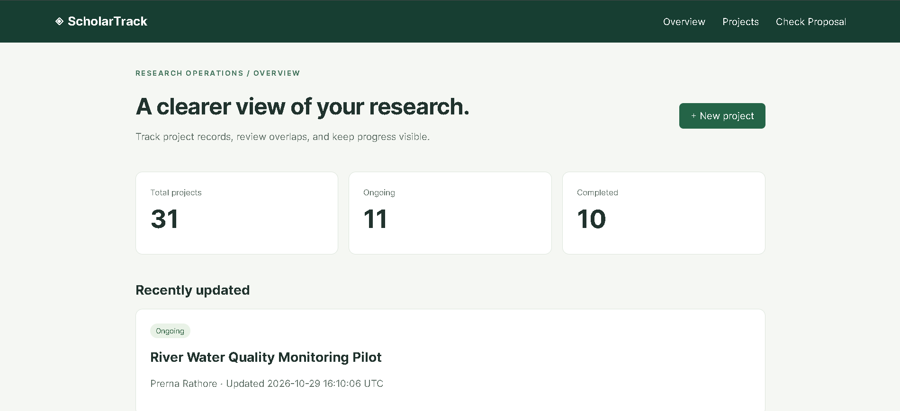
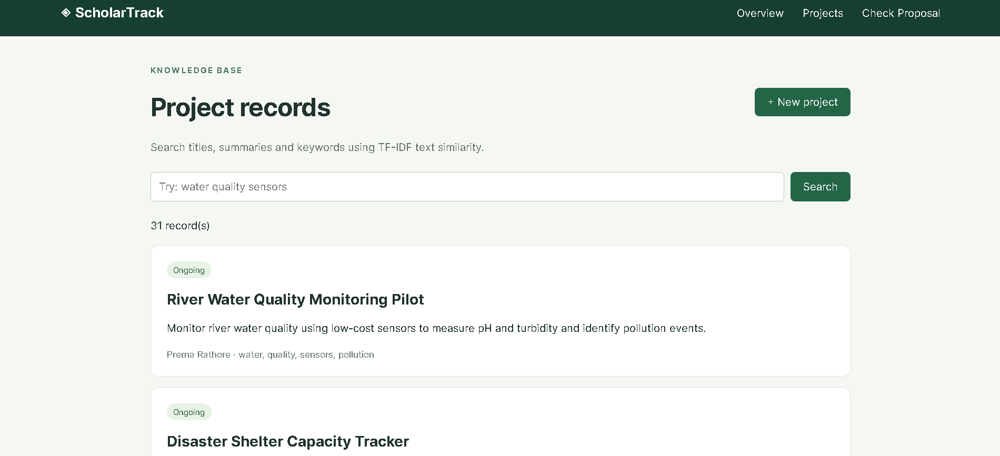
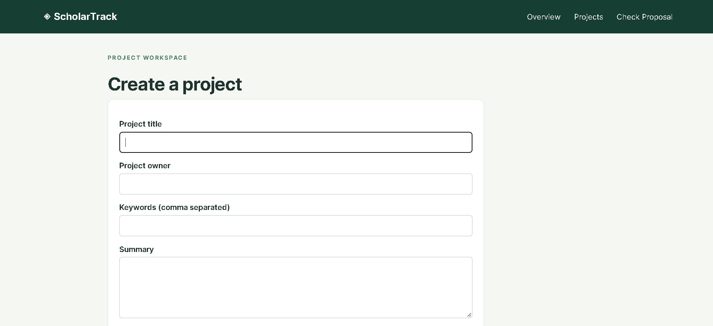
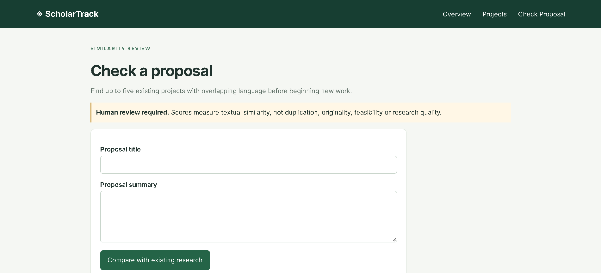
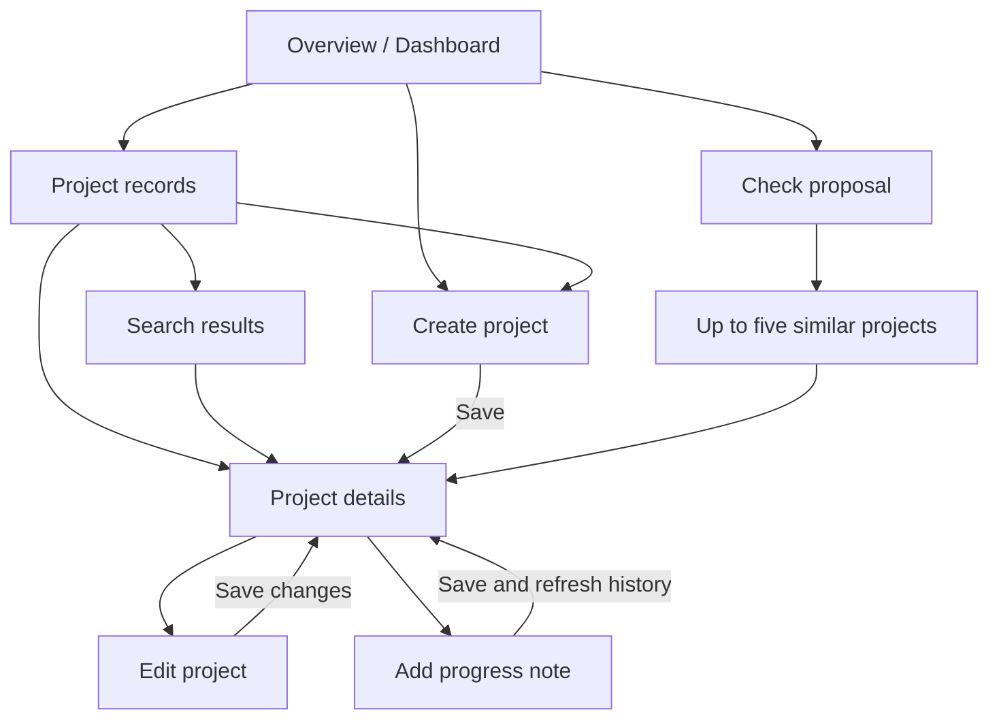

<div align="center">

# ◈ ScholarTrack

### Research Project Records & Similarity Search

Organize research. Track progress. Discover related work.


**[Overview](#overview) · [Screenshots](#screenshots) · [Page Flow](#page-flow) · [Run Locally](#run-locally) · [Testing](#testing)**

</div>



## Overview

ScholarTrack is a full-stack Python prototype for managing research project records and finding projects with similar text. It brings project metadata, progress notes and change history into one local application, with TF-IDF retrieval to help reviewers explore related work before starting a proposal.

The application uses FastAPI, server-rendered Jinja2 templates, SQLite through SQLAlchemy, and scikit-learn for text similarity. No external AI service or API key is required.

> **Prototype status:** Runs locally with fictional demonstration records. Six automated integration tests passed on the developer's Windows Python 3.10.7 environment. Authentication and production deployment hardening are future work.

## Features

| Area | What you can do |
|---|---|
| Dashboard | View total, ongoing and completed counts, plus recently updated projects. |
| Project records | Create, edit and reopen records with title, summary, owner, keywords and status. |
| Search | Rank projects by TF-IDF cosine similarity across titles, summaries and keywords. |
| Proposal comparison | Compare a title and summary against existing records; view up to five positive-score matches. |
| Progress tracking | Save notes and completion percentages with actor names and UTC timestamps. |
| Activity history | Inspect creation events, before/after edits and progress changes. |
| Validation | Check required fields, text lengths, valid status and completion range. |
| Demo data | Populate an empty database with 30 fictional research projects. |

## Screenshots

The dashboard above shows a database after one additional demonstration project was created: **31 total, 11 ongoing and 10 completed**. A fresh seed creates **30 total, 10 ongoing, 10 completed and 10 planned**.

### Project records

Browse stored research, inspect summaries and keywords, or enter a search query.



### Create a project

Capture project metadata in a shared create/edit form. The screenshot shows the upper portion of the creation form.



### Check a proposal

Enter a proposal title and summary to retrieve related records. The screenshot shows the input form before comparison.



## Page Flow



The shared navigation links to **Overview**, **Projects** and **Check Proposal** from every page.

| Page | Route | Main action |
|---|---|---|
| Dashboard | `/` | Review counts and recent updates. |
| Project list/search | `/projects` | Browse records or search using `?q=...`. |
| Create project | `/projects/new` | Submit a new record. |
| Project details | `/projects/{id}` | View the brief, progress notes and history. |
| Edit project | `/projects/{id}/edit` | Update metadata and record field changes. |
| Check proposal | `/proposal` | Submit proposal text and inspect ranked matches. |

### Typical workflow

1. Open **Overview** to review project counts and recent changes.
2. Select **New project**, enter metadata and your actor name, then save.
3. Review the saved record on its **Project details** page.
4. Select **Edit project** when metadata changes; inspect the resulting history entry.
5. Add a progress note and completion percentage to record work over time.
6. Open **Projects** and search for related topics.
7. Open **Check Proposal**, enter a proposed title and summary, and compare the closest records manually.

## How Similarity Search Works

1. Combine each stored project's **title, summary and keywords** into a document.
2. Fit `TfidfVectorizer` on existing project documents using English stop words, unigrams/bigrams and sublinear term frequency.
3. Transform the search query or proposal text with the same vocabulary.
4. Calculate cosine similarity against the project matrix.
5. Exclude zero-score records and sort positive matches by descending score. Ties use ascending project ID.
6. For proposals, return at most five matches.

**Search behavior:** An empty search displays all projects. A query with no shared vocabulary returns no matches. Proposal inputs are validated before comparison. Checking a proposal does not create a project.

> **Human review required.** Displayed percentages are cosine scores multiplied by 100. They are not probabilities, plagiarism percentages or proof of originality. This lexical approach can miss paraphrases and return small scores from incidental shared terms.

## Architecture

| Layer | Implementation |
|---|---|
| Interface | HTML, CSS and Jinja2 templates |
| Application | FastAPI routes, validation and form handling |
| Persistence | SQLAlchemy ORM with SQLite |
| Retrieval | scikit-learn TF-IDF and cosine similarity |
| Verification | pytest with FastAPI TestClient and isolated SQLite databases |

### Database tables

| Table | Stored information |
|---|---|
| `projects` | Metadata, status, completion, `created_at`, `updated_at` |
| `progress_updates` | Project reference, note, percentage, actor, creation time |
| `activity_log` | Project reference, actor, action, JSON change details, creation time |

Project writes and related history are committed in the same transaction. No-op edits do not generate history entries. Status and completion are independent: setting completion to 100 does not automatically change the status.

## Run Locally

### Requirements

- Python **3.10 or newer**; verified with Python 3.10.7 on Windows and Python 3.12 during initial development.
- pip and a terminal.
- The complete project folder containing `app/` and `requirements-dev.txt`.

SQLite comes with Python. Node.js, npm and an external database server are not required.

Download or clone this repository, then open a terminal **inside the folder containing `requirements-dev.txt`**.

### Windows PowerShell

```powershell
# Create an isolated environment with your installed Python.
py -3 -m venv .venv

# Install dependencies without needing to activate the environment.
.\.venv\Scripts\python.exe -m pip install --upgrade pip
.\.venv\Scripts\python.exe -m pip install -r requirements-dev.txt

# Create tables and seed the empty database.
.\.venv\Scripts\python.exe -m app.seed

# Start the application.
.\.venv\Scripts\python.exe -m uvicorn app.main:app --reload
```

### macOS / Linux

```bash
python3 -m venv .venv
source .venv/bin/activate
python -m pip install --upgrade pip
python -m pip install -r requirements-dev.txt
python -m app.seed
python -m uvicorn app.main:app --reload
```

Open **http://127.0.0.1:8000**. Keep the terminal running; stop the server with **Ctrl+C**.

The default database is `research.db` in your current working directory. Run commands from the project root to consistently use the same database. The seed command skips insertion when the project table is nonempty. App startup also creates tables without adding seed data.

### Run again later

On Windows, reopen the project folder and run:

```powershell
.\.venv\Scripts\python.exe -m uvicorn app.main:app --reload
```

Existing records remain in the SQLite file. There is no need to reinstall dependencies or reseed on every start.

### Optional database location

Set `DATABASE_URL` before starting the server to use another SQLite file:

```powershell
$env:DATABASE_URL = "sqlite:///./scholartrack.db"
.\.venv\Scripts\python.exe -m app.seed
.\.venv\Scripts\python.exe -m uvicorn app.main:app --reload
```

This uses a separate database; it does not move records from the original file.

## Testing

From the project root on Windows:

```powershell
.\.venv\Scripts\python.exe -m pytest -q
```

On macOS/Linux with the environment activated:

```bash
python -m pytest -q
```

Recorded Windows result:

```text
6 passed, 1 warning in 8.27s
```

| Test area | Coverage |
|---|---|
| Creation | Valid records, rejected invalid title, initial activity actor and missing record |
| Editing | Persisted metadata changes and before/after activity details |
| Relevant search | Relevant results and no-match behavior |
| Empty search | Blank queries return available records |
| Proposal ranking | Closest record first, zero-score exclusion, review label and input validation |
| Progress | Persisted note, completion, updated timestamp, history and invalid percentage |

Tests use an isolated in-memory SQLite database and do not modify demonstration records. The recorded warning concerns the dependency's deprecated `httpx` TestClient integration; it did not fail the suite.

### Manual demonstration

1. Create **River Water Monitoring Pilot** with a water-quality sensor summary.
2. Edit its title and inspect before/after history.
3. Record **Installed and calibrated the first sensor** at **40%** completion.
4. Refresh the page to verify persistence.
5. Search **water quality sensors**.
6. Compare a proposal using similar language and inspect the ranked matches.
7. Restart the application and confirm the saved record remains available.

## Project Structure

```text
app/
    __init__.py
    main.py                 # Models, routes, validation and retrieval
    seed.py                 # 30 fictional demo projects
    static/
        style.css
    templates/
        base.html
        dashboard.html
        detail.html
        form.html
        projects.html
        proposal.html
scripts/
    capture_screenshots.py
screenshots/
    dashboard.png
    projects.png
    create-project.png
    check-proposal.png
tests/
    test_app.py
.gitignore
pytest.ini
requirements.txt
requirements-dev.txt
requirements-tested.txt
README.md
```

`research.db` and `.venv/` are created locally and should remain excluded from Git.

## Current Scope

ScholarTrack is a local prototype with fictional data. Actor names are entered by the user and are not verified identities. It does not yet provide authentication, authorization, CSRF protection, migrations, deletion, pagination or production deployment configuration.

The search index is rebuilt per request, which keeps this small implementation simple. Larger datasets would benefit from a cached, versioned index and measured retrieval performance. Use fictional or non-sensitive records for demonstrations.

## Roadmap

- [ ] Authentication and role-based access
- [ ] CSRF protection and deployment configuration
- [ ] Database migrations
- [ ] Pagination and status/owner filters
- [ ] Cached retrieval index
- [ ] Semantic embeddings with retrieval evaluation
- [ ] CSV/PDF reporting and record exports

## Author

**Prerna Rathore** · [GitHub](https://github.com/prerna164)

Built as a practical full-stack Python prototype combining persistent research records, progress tracking and classical NLP retrieval.
